# MiniEngine

> C++20과 DirectX 11로 Win32 창 생성부터 렌더링 파이프라인, Actor/Component 생명주기까지 직접 구현하며 게임 엔진의 내부 구조를 학습하는 개인 프로젝트입니다.

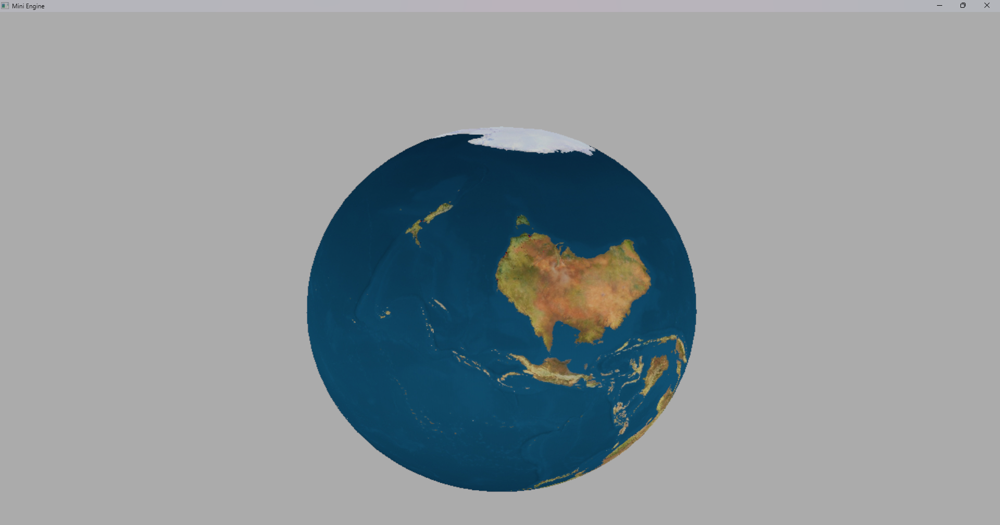

<sub>OBJ 메시 파싱 · WIC 텍스처 로딩 · WVP 변환 · 자유 시점 카메라를 연결한 데모</sub>

## 현재 상태

기준 커밋: [`0fc50dc`](https://github.com/yj9809/MiniEngine/commit/0fc50dc5f37299e2cb343cf61846ba8a61da460b) (2026-10-17)

개편된 Notion 로드맵은 Bootstrap / Shutdown과 Level 전환을 완료 기준선으로 두고, **1단계 Environment Lighting → 2단계 Quaternion 회전** 순서로 진행합니다. 최신 코드는 시작 Level과 런타임 후보를 같은 활성화 경로로 처리하고, Tick·Draw·Actor 처리·입력 정리가 끝난 프레임 경계에서 Level을 교체합니다. 후보 활성화가 실패하면 후보만 정리하고 기존 Level을 유지하며, 전환·종료 콜백 중 추가 요청은 거부합니다.

Component는 Actor가 `Constructed` 상태일 때만 추가할 수 있도록 현재 지원 범위를 코드로 고정했습니다. Level은 Actor 처리 재진입·처리 중 추가·종료 중 추가를 거부하고, 제거되는 Actor가 소유한 MainCamera 관찰 포인터를 메모리 해제 전에 비웁니다. ResourceManager 캐시의 재사용·로드 실패 후 재시도·외부 `shared_ptr` 수명과 Mesh의 부분 GPU 버퍼 생성 실패 정리를 검증하는 테스트 코드도 프로젝트에 연결됐습니다.

Environment Lighting의 첫 코드로 `Light`는 Intensity, `DirectLight`는 Color, `DirectionalLight`는 방향광 타입, `SkyLight`는 SkyColor·GroundColor와 기본 Intensity 0.1을 소유하도록 계층을 분리했습니다. `SkyLightComponent`는 값 검증과 수명 종료 이후 변경 거부를 수행하고 `LightingSystem`의 비소유 목록에 등록·해제됩니다. 현재는 매 수집 시 하늘·지면의 색×강도를 합산하고, 프레임 값 복사 → GPU 패킹 → OpaqueLayer 업로드 → World +Z 기준 Hemisphere Ambient HLSL까지 연결했습니다. Game의 `--colored-ambient` 옵션으로 방향광 없이 색 환경광을 관찰할 수 있습니다.

Quaternion의 Identity·정규화·켤레·역원에 이어 Hamilton Product, Axis-Angle 입력, Euler 입력 변환, 벡터 회전, Nlerp/Slerp와 최단 경로 처리가 수학 값 타입으로 구현됐습니다. 실패 가능한 변환·회전·보간 API는 `bool`과 출력 매개변수로 결과를 구분합니다. `Matrix4::Rotation`과 `Quaternion::TryFromEuler`는 같은 Unreal식 Roll/Pitch/Yaw 방향을 사용하도록 맞췄지만, `TransformComponent`는 여전히 Euler `Vector3`를 회전 원본으로 저장합니다. Quaternion은 아직 Transform·Camera·DirectionalLight의 실제 회전 경로에 통합되지 않았습니다.

`a32014f`에서는 Debug / Release x64에서 당시 118개 테스트가 모두 통과했다는 실행 기록이 있습니다. 최신 `0fc50dc` 소스는 정적 집계상 325개 실행 케이스가 예상됩니다. 개발 일지에는 `4ba8c95` 변경 범위의 Quaternion·Matrix4·TransformEuler·LightingSystem·RenderingSystem 173개가 Debug / Release에서 각각 통과했다는 기록이 있지만, 이후 문서 병합까지 포함한 최신 `0fc50dc` 전체 325개 실행 결과는 아닙니다. 회전 GIF도 Euler 데모 기록이므로 Quaternion Transform 통합을 증명하지 않습니다. 구현 존재, 시스템 통합, 테스트 코드, 실행 검증을 구분하며 범용 엔진 전체의 완성을 의미하지 않습니다.

완성된 범위와 현재 확장 중인 범위를 구분하면 다음과 같습니다.

| 영역 | 현재 수준 | 상태 |
|---|---|---|
| Win32 런타임 | 창, 메시지 루프, 목표 프레임 루프, HWND·등록 클래스 RAII 정리 | 구현 / Window 실패 주입 검증 대기 |
| Engine Bootstrap | `Create(EngineCreateInfo)` → Settings·Renderer 단계 오류 → 시작 Level 활성화 → Game의 오류 분기 | 실패 전파 코드 연결·관련 테스트 6개 구성 / 최신 전체 실행 검증 대기 |
| Actor / Component | `Initialize` → `BeginPlay` → `OnDestroy`, 실패 상태, 정리 예외 수집, Root Transform | 구성 단계 추가만 지원하도록 제한 / 최신 테스트 실행 대기 |
| 수학·Quaternion | Vector 정규화 실패 계약, `TryLookAt`, Quaternion 기본 연산·변환·벡터 회전·보간 | 2-1 수학 구현 / Transform 연결·최신 전체 실행 검증 대기 |
| Level 전환 | 요청 결과, pending Level 소유권, 단계 오류, 프레임 경계 교체 | Engine 루프 통합 / `a32014f` Debug·Release 6개 전환 테스트 포함 118개 통과 |
| DX11 기반 | Device · SwapChain · RTV · DSV · Viewport · 상수 버퍼 | 완료 |
| 3D 렌더링 | WVP, 자유 시점 카메라, 깊이 테스트, Indexed Draw | 완료 |
| 에셋 | OBJ 파서, WIC 텍스처 로더, GPU 핸들 관리, 경로별 `ResourceManager` 공유 캐시 | 데모 소비 경로 연결 / 캐시·실패 테스트 구성, 최신 실행 대기 |
| Material | BaseColor · MainTexture, PS 상수 버퍼 연동 | 완료 |
| 기본 조명 | World Normal, Directional Lambert, Hemisphere Ambient, Albedo 단일 곱셈 | 코드 연결 / 환경광 비교 화면 기록, 최신 전체 회귀 대기 |
| LightingSystem | Level 단위 비소유 등록·해제, 방향광 수집, 다중 SkyLight 색×강도 합산 | CPU 프레임 데이터 연결 |
| Environment Lighting | SkyLight → RenderData → 프레임 복사 → GPU 패킹 → Hemisphere HLSL → Game | 1-2 완료 / 관련 60개 테스트·비교 캡처 확인, 최신 전체 회귀와 구분 |
| RenderingSystem | 메시 명령·방향광·환경광 프레임 값을 렌더러에 제출 | Level Draw와 연결 / 최신 전체 테스트 실행 대기 |
| 방향광 GPU 경로 | 수집 순서상 최대 4개 패킹·업로드, 개수 기반 셰이더 누적 | 코드 연결 / 용량·초과·GPU readback 테스트 소스 존재 |
| 충돌 | `BoxCollider`, AABB overlap, 등록 컨테이너 | 기반 구현 / 게임 루프 통합 미완료 |

## 무엇을 직접 구현했는가

### 렌더링 파이프라인

```text
MeshRendererComponent
  └─ BeginPlay 등록 / OnRemove 해제
      ↓
Level::Draw → RenderingSystem
  └─ RenderCommand 구성 · 제출
      ├─ Buffer / Texture Handle
      ├─ World · View · Projection
      └─ Material BaseColor
          ↓
LayerScheduler
  ├─ OpaqueLayer
  │   ├─ WVP / World / Material / Lighting Constant Buffer
  │   └─ Mesh VS · PS + Texture SRV
  └─ WireframeLayer
      └─ 전용 VS · PS와 Rasterizer State
          ↓
Direct3D 11 DrawIndexed

DirectionalLightComponent
  └─ LightingSystem 등록 · CPU RenderData 수집
      ↓
RenderingSystem → D3D11Renderer::RenderFrameData
  └─ OpaqueLayer Lighting Constant Buffer
      └─ 최대 4개 방향광 → Mesh Pixel Shader

SkyLightComponent
  └─ LightingSystem 등록 · 색×강도 합산
      ↓
EnvironmentLightingRenderData → RenderFrameData 값 복사
  └─ BuildLightingConstantBuffer → OpaqueLayer PS b1
      └─ World +Z Hemisphere Ambient → Mesh Pixel Shader
```

- `IRenderer`와 `D3D11Renderer`를 분리해 게임 코드가 D3D11 구현 세부사항을 직접 참조하지 않도록 구성했습니다.
- `RenderingSystem`이 현재 Level에 등록된 `MeshRendererComponent`를 순회하고, 카메라의 View/Projection과 각 Actor의 World 행렬로 `RenderCommand`를 구성해 제출합니다.
- Component 생명주기의 비공개 시스템 훅이 `BeginPlay` 직전에 등록하고 `OnRemove` 직전에 해제합니다. `LightComponent`가 Level의 `LightingSystem` 연결을 공통 처리하고, 구체 광원은 타입별 등록·해제만 구현합니다.
- `DirectionalLightComponent`는 Root Transform의 +X Forward를 방향으로 사용하고, 색상·강도와 함께 CPU 렌더 데이터로 변환합니다. `LightingSystem`이 등록된 방향광 전체를 수집해 `RenderingSystem`과 `D3D11Renderer`의 프레임 데이터로 전달합니다.
- `SkyLightComponent`는 SkyColor·GroundColor·Intensity를 보유하고, 음수·NaN·무한대 입력과 종료 중/종료 후 변경을 거부합니다. `LightingSystem`이 매 수집 시 SkyColor·GroundColor에 강도를 한 번 곱해 각각 합산합니다. 광원이 없으면 0이고 별도 합산 캐시를 두지 않습니다.
- `RenderingSystem`은 환경광이 없을 때도 0을 제출하며, `D3D11Renderer`는 프레임 값을 복사하고 BeginFrame·Shutdown에서 초기화합니다. `BuildLightingConstantBuffer()`는 D3D 호출 없이 값을 패킹하고 OpaqueLayer는 Map·업로드·바인딩을 담당합니다.
- 방향광은 수집 순서상 최대 4개를 패킹·업로드하고 초과분은 제외합니다. 환경광 두 RGB 기여는 w=0으로 전달하며 HLSL은 `saturate(N.z * 0.5 + 0.5)`로 하늘·지면을 보간합니다. 최종 출력에서 Albedo를 한 번만 곱합니다.
- 렌더 요청을 `RenderCommand`로 모은 뒤 Opaque/Wireframe 버킷에서 실행합니다. 현재 구조는 Render Target을 소유하는 진짜 RenderPass가 아니므로 이름을 `RenderLayer`로 정정했습니다.
- OBJ의 position/normal/UV를 파싱하고 중복 정점을 제거해 Vertex/Index Buffer를 생성합니다.
- WIC로 이미지를 RGBA8로 변환하고 Texture2D/SRV를 생성해 픽셀 셰이더에서 샘플링합니다.
- Material의 BaseColor와 Texture를 렌더 명령으로 전달하고, Lambert Diffuse와 Hemisphere Ambient를 적용하는 셰이더 경로를 구현했습니다.

| Directional Lambert만 적용 | Uniform Ambient 추가 |
|---|---|
| 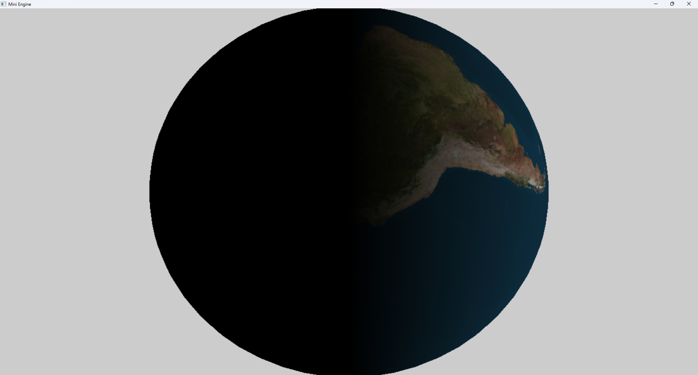 | 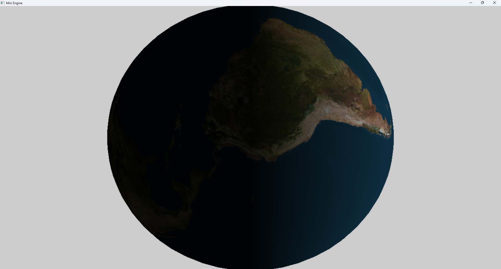 |

왼쪽은 광원이 닿지 않는 면이 완전히 어두운 Lambert 단독 결과이고, 오른쪽은 Uniform Ambient를 더한 과거 결과입니다. 현재 구현은 아래 Hemisphere Ambient 경로로 대체됐습니다.

### 오브젝트와 생명주기

```text
Level
  └─ Actor (unique_ptr 소유)
      ├─ TransformComponent (Root)
      ├─ CameraComponent
      ├─ MeshRendererComponent
      ├─ InputComponent
      └─ Collider / Light Component
```

- Actor가 Component를 `unique_ptr`로 소유하고, 외부에서는 비소유 raw pointer로 관찰합니다.
- 순회 중 컨테이너 무효화를 피하기 위해 Actor 추가·삭제를 프레임 경계에서 일괄 처리합니다.
- 반복 `vector::erase`로 인한 O(n²) 삭제를 swap-and-pop으로 변경했습니다. 당시 개발 일지의 10,000개 일괄 삭제 측정은 1046ms에서 12ms로 감소했습니다.
- “객체 구성”과 “런타임 진입”이 섞여 있던 문제를 분리해 `Initialize`와 `BeginPlay` 디스패치를 추가하고, 중복 호출·재진입·순서 역전을 상태로 차단했습니다.
- 종료도 `DispatchOnDestroy()` → Actor `OnDestroy()` → Component `OnRemove()` 순으로 일원화하고, 중복 종료를 상태로 차단했습니다. 메시 렌더러와 광원 컴포넌트는 실제 등록했던 시스템에서 해제합니다.
- `InitializationFailed`와 `BeginPlayFailed` 상태를 추가해 부분 활성화 실패 후에도 제거 디스패치에 진입할 수 있게 했습니다. `CleanupExceptionCollector`는 Actor·Component·Level의 각 정리 작업을 모두 시도한 뒤 처음 발생한 예외를 다시 전달합니다.
- 현재 Level에 대기 중인 Actor는 프레임 경계에서 `DispatchInitialize()` → `DispatchBeginPlay()` 순으로 진입합니다. Component 추가는 Actor가 `Constructed` 상태일 때만 허용하며, Initialize 진입 이후의 동적 추가는 `std::logic_error`로 명시적으로 거부합니다.

### 엔진 생성과 초기화

- `Engine::Create(EngineCreateInfo)`는 `std::variant<std::unique_ptr<Engine>, EngineInitError>`를 반환합니다. 생성자는 비공개이고, 초기화는 Settings → Window → Renderer → Resource → StartupLevel 순으로 수행합니다.
- `Game/Main.cpp`는 Camera, TestMesh, DirectionalLight Actor를 넣은 시작 Level을 `EngineCreateInfo`로 넘깁니다. Engine은 서비스 연결 → `BeginPlay()` → 대기 Actor 처리까지 마친 뒤 생성 결과를 반환하며, Game은 성공한 경우에만 `Run()`을 호출합니다.
- null 시작 Level은 창 생성 전에 `StartupLevel` 오류로 거부합니다. 초기 Actor의 `Initialize` → `BeginPlay` 순서를 `Run()` 호출 전에 검증하는 테스트도 추가했습니다.
- `Win32Window`는 소멸자에서 HWND와 등록 클래스를 정리합니다. `D3D11Renderer`도 소멸자에서 Layer·GPU 리소스·COM을 정리합니다. `Engine`은 종료 진입 전에 Level 전환 가드를 세워 정리 콜백의 재진입 요청을 거부하고, pending Level → 활성 Level → ResourceManager → Renderer → Window 순으로 소유 객체를 해제합니다.
- Opaque/Wireframe Layer의 필수 초기화를 `assert()` 표현식 밖으로 옮겼습니다. 생성 실패는 예외로 Renderer와 Engine 경계까지 전달돼 `EngineInitialization::Renderer` 단계의 `EngineInitError`로 변환됩니다.
- 시작 Level의 `BeginPlay()`가 실패한 뒤 두 번째 Engine 생성이 성공하는 회귀 테스트로 한 실패 경로의 자원 반환을 확인했습니다. 모든 D3D 단계의 실패 주입과 정확한 해제 순서 계측까지 끝난 것은 아닙니다.
- `EngineCreateInfo::settingsPath`로 설정 경로를 주입합니다. 파일 생성·열기·읽기·쓰기 오류와 비정상 값은 `Settings` 단계 오류로 반환하며, 디렉터리 경로와 잘못된 값 테스트를 추가했습니다.
- `Level::EndLevel()`은 종료 상태를 정리 전에 기록하고 재호출을 무시합니다. 파생 Level이 가상 재정의로 가드를 우회하지 못하도록 비가상 함수로 고정했습니다.
- `D3D11Renderer::GPUInit()`은 Device, SwapChain, RenderTarget, DepthStencil, RenderLayer, PlatformRuntime 실패를 `RendererInitError`로 구분합니다. Engine 외부에는 `EngineInitialization::Renderer`와 오류 메시지로 변환되므로 Renderer의 세부 enum 자체는 Game까지 전달되지 않습니다.
- 초기화 경로의 기존 `FAILCHECK`는 제거됐지만 런타임 Buffer·Texture 생성과 `Map()` 실패 정책은 아직 통일되지 않았습니다.
- Engine은 `final`이며 Game은 상속 대신 생성 결과를 받아 조합합니다. `RequestLevelChange()`는 null·busy·accepted를 구분하고 accepted일 때만 pending Level 소유권을 가져옵니다. `Run()`은 프레임 작업이 끝난 뒤 `ProcessPendingLevelChange()`를 호출하며, 후보 활성화 실패 시 단계 오류를 보관하고 기존 Level을 유지합니다.
- Level의 Actor 처리와 Engine의 Level 전환 가드는 공통 `ScopedFlag` RAII 보조 타입으로 복귀를 보장합니다. Level은 처리 중 추가·재진입·종료를 거부하고, MainCamera를 소유한 Actor가 제거될 때 관찰 포인터를 먼저 해제합니다.
- 전환 성공·실패·종료 예외·Quit 시 후보 해제는 `a32014f`의 실제 `Engine::Run()` 기반 6개 테스트로 확인됐습니다. Game의 전환 UI와 오류 표시, 최신 `cc0471b` 전체 회귀 실행은 별도 검증 대상입니다.

### 기반 시스템

| 시스템 | 구현 내용 |
|---|---|
| Math | `Vector2/3/4`, `Matrix4`, `Quaternion`, 안전 정규화·`TryLookAt`, 행렬 곱·역행렬·투영 |
| Input | Pressed / Held / Released, 마우스 delta, 커서 잠금, Command 바인딩 |
| Time | `QueryPerformanceCounter`, DeltaTime, 이동 평균, clamp, TimeScale, Pause/Resume |
| Camera | WASD 이동, 마우스 우클릭 회전, View / Projection 분리 dirty flag |
| Logging | 모든 빌드 구성에서 `OutputDebugStringA`와 표준 스트림으로 출력 |
| Resource | Engine 소유, 메시·텍스처 경로별 `shared_ptr` 캐시, Renderer보다 앞선 정리 순서 |
| System | Level 소유 Lighting / RenderingSystem, 생명주기 등록·해제, CPU 프레임 데이터 전달 |

## 데모

### Hemisphere Environment Lighting

빌드 출력 폴더에서 `Game.exe --colored-ambient`로 실행합니다. Visual Studio에서는 Game의 명령 인수에 `--colored-ambient`를 지정합니다. 이 모드는 방향광을 배치하지 않고 SkyColor (0.2, 0.5, 1.0), GroundColor (1.0, 0.2, 0.06), Intensity 0.5의 SkyLight를 배치합니다. 옵션이 없으면 Intensity 0.1의 방향광 데모를 실행합니다.

| 색 환경광 실행 자료 | 무광원 비교 자료 |
|---|---|
| 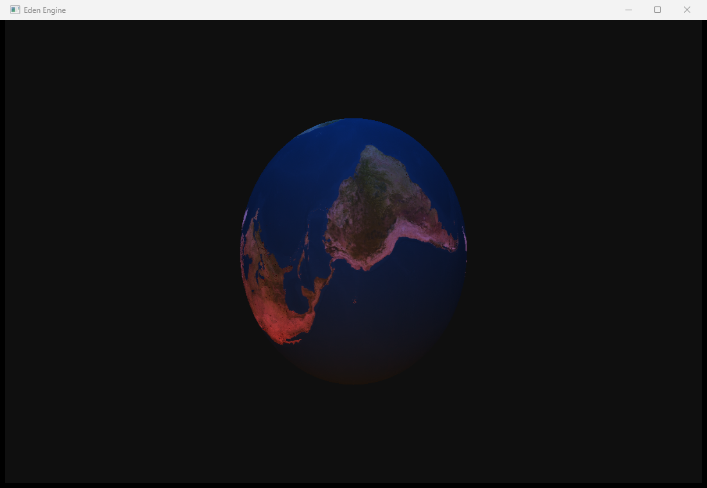 | 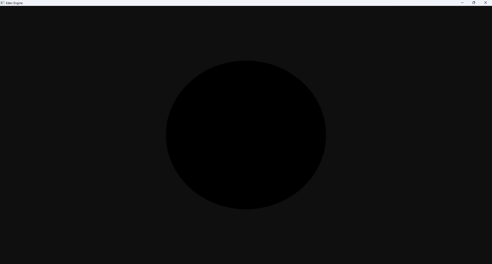 |

| 색 환경광 Intensity 0.1 자료 | 색 환경광 Intensity 0.5 자료 |
|---|---|
| 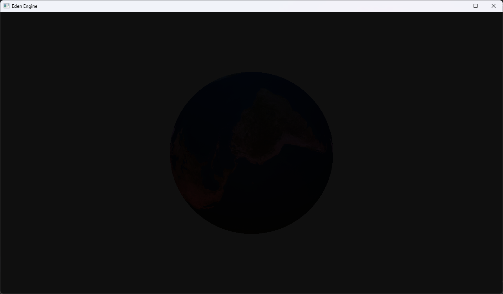 | 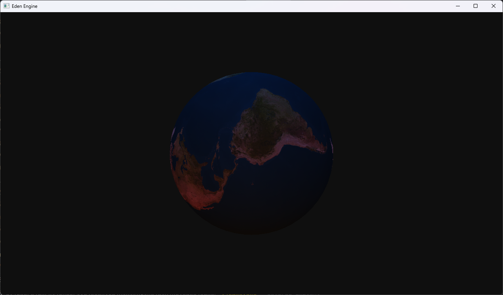 |

2026-10-15에 게시된 자료에서 색과 밝기 차이를 확인했습니다. 강도·무광원 조건명은 파일명과 커밋 설명에 근거하며 화면에 실행 SHA·빌드 구성은 없습니다. 현재 main의 기본 옵션은 위 0.5 설정이고, 무광원·0.1 전환용 실행 옵션은 없습니다. 캡처를 최신 SHA 전체 빌드·테스트 통과 또는 동일 조건 재현의 증거로 사용하지 않습니다.

### 방향광 데모

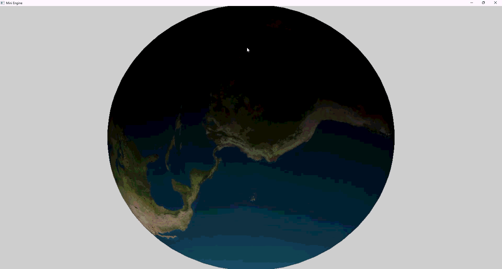

`DirectionalLightActor`는 생성자에서 광원 Component를 구성하고, Initialize에서 흰색·Intensity 0.1과 초기 회전을 설정합니다. Tick에서 Pitch를 초당 100도 증가시키며, Game/Main이 이를 Level에 추가합니다.

이 GIF는 `DirectionalLightActor`를 추가하기 전 `Mini Engine` 빌드의 실행 기록입니다. 현재 Bootstrap의 창 제목은 `Eden Engine`이며, 캡처에 SHA와 빌드 구성을 함께 남기지 않았습니다. 따라서 현재 기준 커밋의 시작 Level·생명주기 실패 경로와 Color/Intensity 변경, 다중 광원 동작은 별도 실행 기록이 필요합니다.

### 회전 규칙과 실행 기록

`TransformComponent`의 Euler 입력은 `Vector3(x, y, z) = Pitch, Yaw, Roll` 도 단위이며 +X를 Forward로 사용합니다. Transform은 이를 라디안으로 바꿔 `Matrix4::Rotation(Roll, Pitch, Yaw)`에 전달하고, Matrix4가 내부에서 `RotationX(-Roll) * RotationY(-Pitch) * RotationZ(Yaw)`로 Unreal식 방향을 적용합니다. `Quaternion::TryFromEuler`도 같은 자세를 만들도록 맞췄지만 Transform의 저장 원본은 아직 Euler입니다. 데모에서는 `1` / `2` / `3` 키로 Pitch / Yaw / Roll 회전을 각각 토글합니다.

| Pitch 회전 | Yaw 회전 | Roll 회전 |
|---|---|---|
| 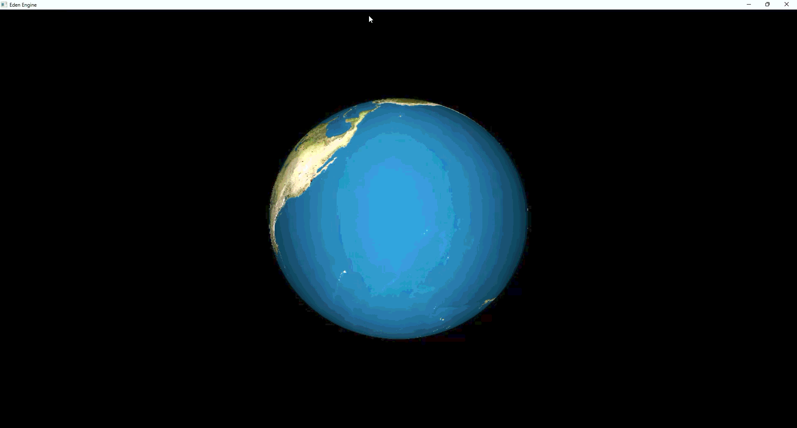 | 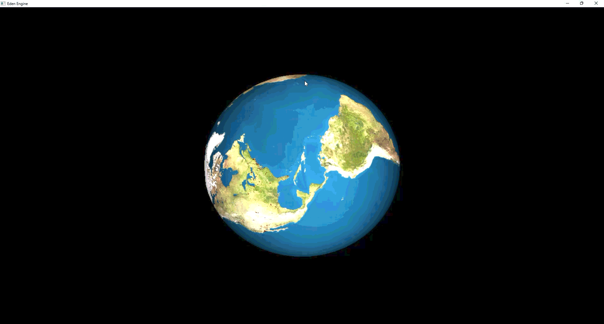 | 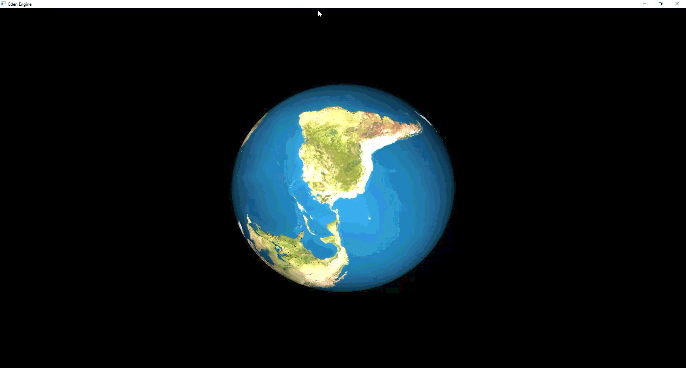 |

| Pitch 0도 비교 | Pitch 90도 짐벌락 비교 |
|---|---|
| 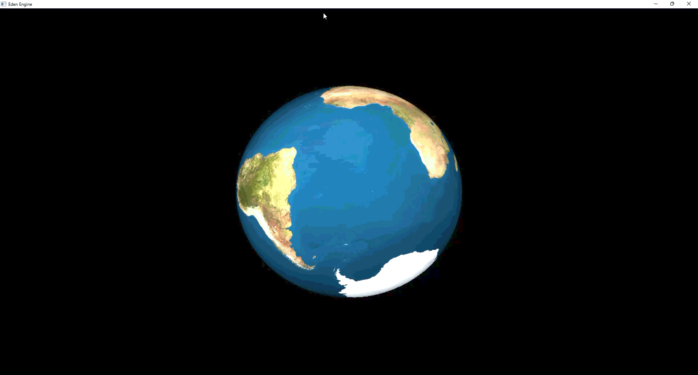 | 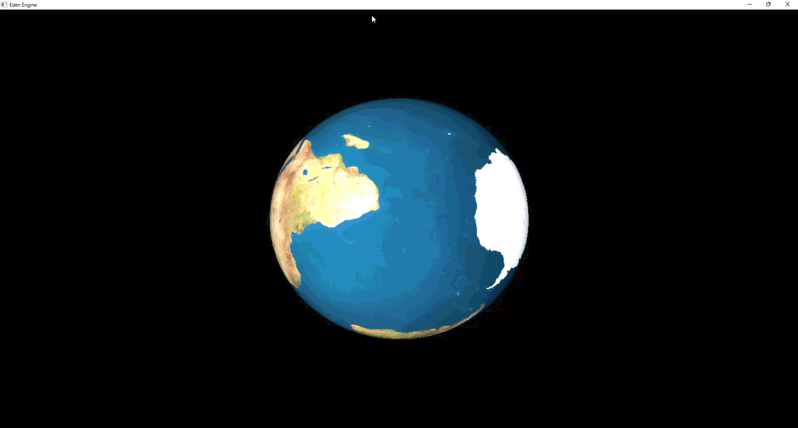 |

2026-10-15에 새로 기록한 회전 GIF입니다. Pitch / Yaw / Roll은 각각 76 / 75 / 77프레임, Pitch 0도 / 90도 비교는 각각 147 / 169프레임이며, 원본과 동일한 파일을 연결했습니다. 기존 회색 배경의 Roll 캡처와 달리 검은 배경에서 지구의 회전을 확인할 수 있습니다.

Pitch 0도 / 90도 조건은 캡처 파일의 구분이며, 화면에 입력 키·각도값·빌드 SHA를 함께 남기지는 않았습니다. 따라서 이 자료는 회전과 짐벌락 비교를 위한 실행 기록으로 남기고, 현재 main의 정확한 입력 조건 재현이나 Quaternion 전환 완료 근거로 확대하지 않습니다. 현재도 쿼터니언 도입 전까지 오일러 회전의 짐벌락 가능성은 남아 있습니다.

## 빌드와 검증

### 요구 환경

- Windows 10/11
- Visual Studio 2026 Community 또는 MSVC v145 호환 환경
- Windows SDK 10
- vcpkg manifest mode (`vcpkg.json`의 GoogleTest 의존성)
- x64

### 빌드 절차

1. `Engine.slnx`를 Visual Studio로 엽니다.
2. `x64`와 `Debug` 또는 `Release`를 선택합니다.
3. `Game` 프로젝트를 시작 프로젝트로 설정합니다.
4. 빌드 후 실행 파일 옆으로 복사된 `Asset/`과 `Shader/`를 사용해 실행합니다.

테스트는 같은 솔루션의 `Tests` 프로젝트가 `LevelTest.cpp`, `RenderingSystemTest.cpp`, `FailingStartupLevel.cpp`를 포함한 전체 테스트 소스를 빌드하도록 구성되어 있습니다. 테스트 빌드 후에는 구성에 맞는 Engine·GoogleTest DLL과 Game Shader 폴더를 출력 디렉터리로 복사합니다. `LightComponent.cpp`도 Engine 프로젝트 빌드 대상에 등록되어 있습니다.

### 검증 현황

OBJ + Texture + Camera 데모와 Lambert / Ambient 결과는 실행 이미지와 GIF로 남겼습니다. 2026-10-05에는 생명주기·수학·Time의 6개 스위트, 86개 테스트가 모두 통과했습니다. 아래 기존 6개 캡처는 당시 실행 기록이며, 현재 기준 커밋의 전체 회귀 결과는 아닙니다.

최신 `0fc50dc`의 테스트 프로젝트는 정적 집계상 325개 케이스를 등록할 것으로 예상되고, `Tests/Main.cpp`는 필터 없이 `RUN_ALL_TESTS()`를 호출합니다. 이 수는 최신 SHA의 실행 통과 수가 아닙니다.

| 스위트 | 케이스 | 범위 |
|---|---:|---|
| Vector2 / 3 / 4 | 2 / 19 / 18 | 산술, 내적·외적, 정규화, 상수 |
| Matrix4 | 27 | 변환, 역행렬, LookAt, 투영, Unreal식 Euler 방향·혼합 기저 |
| TransformEuler | 1 | Transform의 Pitch/Yaw/Roll 도 입력, World 기저·Forward(테스트 소스) |
| Quaternion | 123 | 기본 연산, Axis-Angle·Euler, 벡터 회전, Nlerp/Slerp, 수치 경계·최단 경로(테스트 소스) |
| Time | 17 | 스무딩, clamp, TimeScale, Pause/Resume |
| Lifecycle | 14 | 호출 순서, 실패 상태, Component 구성 시점 제한, 종료 순서 |
| Level | 13 | Actor 추가·제거, owner, 대량 처리, EndLevel 중복 호출 방지 |
| LevelBoundary | 4 | null·종료 중 추가 거부, 프레임 경계 지연 추가 |
| LevelProcessingBoundary | 8 | 처리 재진입·추가·종료 거부, 예외 후 가드 복귀 |
| LevelCameraBoundary | 4 | pending/active Actor 제거 전 MainCamera 참조 정리 |
| EngineSettingsInitialization | 2 | 설정 경로 I/O 실패, 잘못된 설정값 오류 반환 |
| EngineInitialization | 3 | null 시작 Level 거부, `Run()` 전 초기 Actor 활성화, 실패 후 재생성 |
| LevelTransitionDeath | 6 | 성공·활성화 실패·정리 예외·Quit와 요청/오류 계약 |
| RenderingSystem | 10 | 중복 등록, 제거 안전성, Level 격리, 명령·환경광 제출 |
| ResourceManager | 12 | Mesh/Texture 캐시, 실패 재시도, 참조 수명, 부분 버퍼 실패 정리 |
| ScopedFlag | 4 | 설정·복귀, 기존 값 보존, 비복사·비이동 계약 |
| SkyLightComponent | 9 | 기본값·유효/무효 값·수명 종료 거부·Release 로그 계약(테스트 소스) |
| LightingSystem | 12 | 환경광 합산·변경·등록/해제·Level 생명주기 |
| LightingPacking | 10 | 환경광 값·w·초기화·CPU 배치, 방향광 0/1/4/초과 |
| LightingGpu / LightingShaderLayout | 6 / 1 | Hardware·WARP 각 3개 GPU 테스트, 생산 셰이더 reflection 배치(소스) |

2026-10-06에는 변경된 Lifecycle 11개와 새 RenderingSystem 6개를 각각 실행해 모두 통과했습니다. 두 스위트를 따로 실행한 기록이므로 당시 전체 106개의 통합 실행 결과와는 구분합니다. 2026-10-09 로드맵에는 `b210cdf` 기준 Release x64 빌드와 전체 106개 테스트 통과를 기록했지만, 원본 실행 로그는 저장소에 남기지 않았습니다.

2026-10-13 개발 일지에는 `a32014f` 기준 Debug / Release x64 테스트 빌드와 각 구성 118개 전체 통과가 기록돼 있습니다. 이후 테스트가 추가되어 최신 `0fc50dc`에는 정적 집계상 325개가 등록될 것으로 예상되지만, 최신 전체 실행 기록은 확인되지 않았습니다. 2026-10-17 개발 일지에는 `4ba8c95` 변경 범위의 관련 173개가 Debug / Release에서 각각 통과했다는 기록이 있습니다. 구성은 Quaternion 123, Matrix4 27, TransformEuler 1, LightingSystem 12, RenderingSystem 10이며 전체 325개 회귀와 구분합니다. 새 ResourceManager 테스트는 대역 Renderer를 사용하므로 통과하더라도 실제 D3D11/WIC 실행 검증과는 구분해야 합니다. 새 GPU 테스트는 실제 OpaqueLayer의 b1 버퍼 readback, probe shader 출력, 생산 MeshPixelShader의 Hemisphere·Albedo·alpha 출력과 컴파일된 셰이더 배치를 검사하도록 작성됐습니다. 테스트 코드 존재는 실행 통과가 아니며 Game 캡처도 최신 SHA의 HLSL 컴파일·Hardware/WARP 테스트 실행 로그를 대체하지 않습니다.

2026-10-15의 로컬 `Bin/{Debug,Release}/Tests/precommit-results.xml`과 실행 로그에서는 환경광 관련 7개 스위트, 각 구성 60개 통과와 실패·오류·비활성 0을 확인했습니다. RenderingSystem 10, SkyLightComponent 9, LightingSystem 12, LightingPacking 10, Shader Layout 1, ResourceManager 12, Hardware/WARP GPU 6개 결과입니다. `5239d8e`·`926c19b` 작업 범위의 기존 실행 기록이며 이번 문서 갱신에서 테스트를 다시 실행하지 않았습니다. 이후 `cc0471b`의 Game 비교 설정 변경이나 195개 전체 회귀 통과 기록과는 구분합니다.

2026-10-17에 수정된 원본 캡처에서는 LightingGpu 6개, LightingPacking 10개, LightingShaderLayout 1개, LightingSystem 12개, RenderingSystem 10개의 개별 OK를 확인했습니다. 아래 Release 표기는 원본 파일명에 근거하며, 화면에는 실행 SHA와 빌드 구성이 표시돼 있지 않습니다. 이번에는 기존 파일을 확인해 게시했으며 테스트를 새로 실행하지 않았습니다.

| LightingGpu (6, Release, 2026-10-17) | LightingPacking (10, Release, 2026-10-17) | LightingShaderLayout (1, Release, 2026-10-17) |
|---|---|---|
| 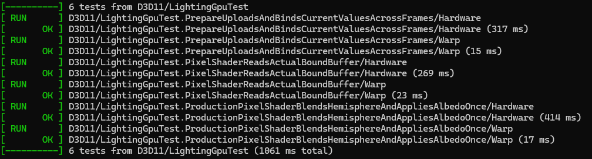 | 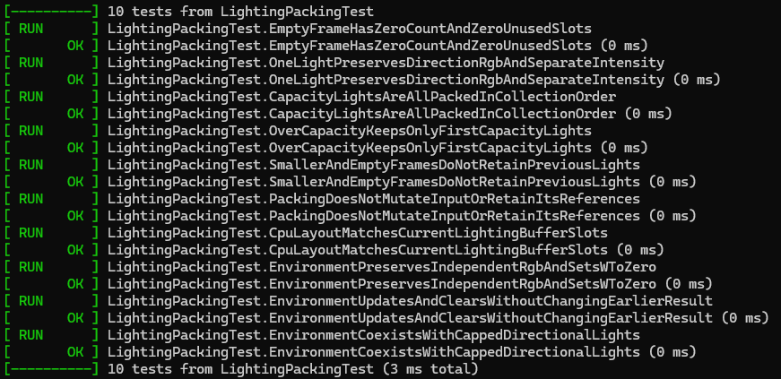 | 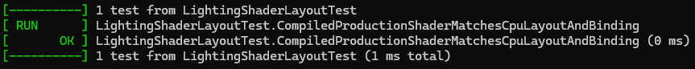 |

| LightingSystem (12, Release, 2026-10-17) | RenderingSystem (10, Release, 2026-10-17) |
|---|---|
| 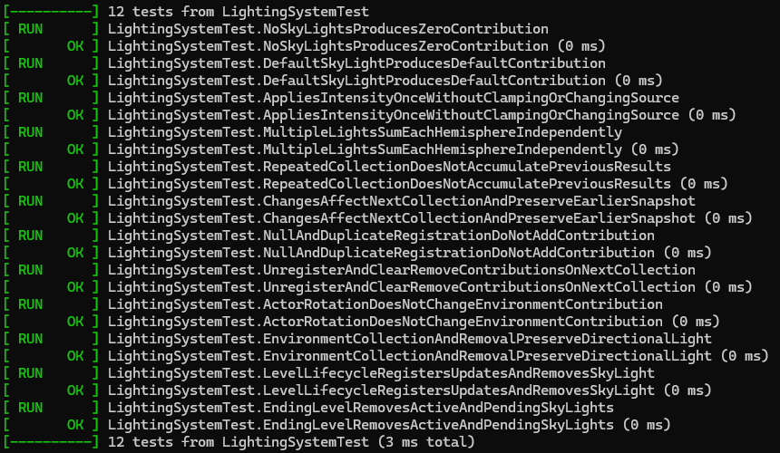 | 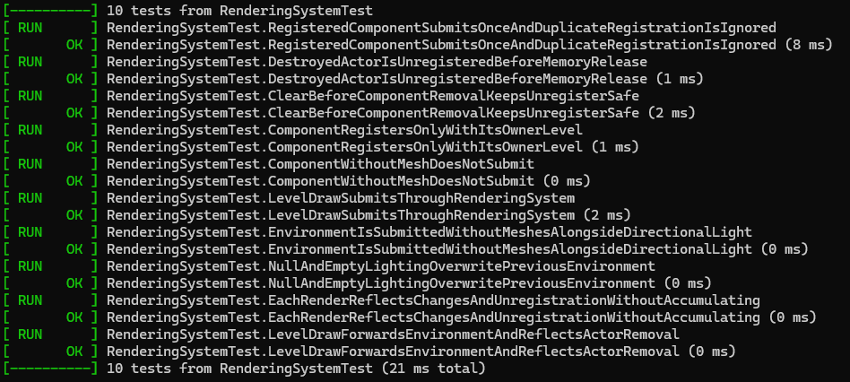 |

같은 날짜의 Quaternion 캡처 4장은 일반 37개와 실패 입력 42개, 총 79개의 개별 OK를 나누어 담았습니다. 기본 연산·Hamilton Product·Axis-Angle 범위의 과거 기록이며, 현재 Quaternion 123개 구성이나 관련 173개·전체 325개 실행 결과를 증명하지 않습니다.

| Quaternion (37, Release, 1/2) | Quaternion (37, Release, 2/2) |
|---|---|
| 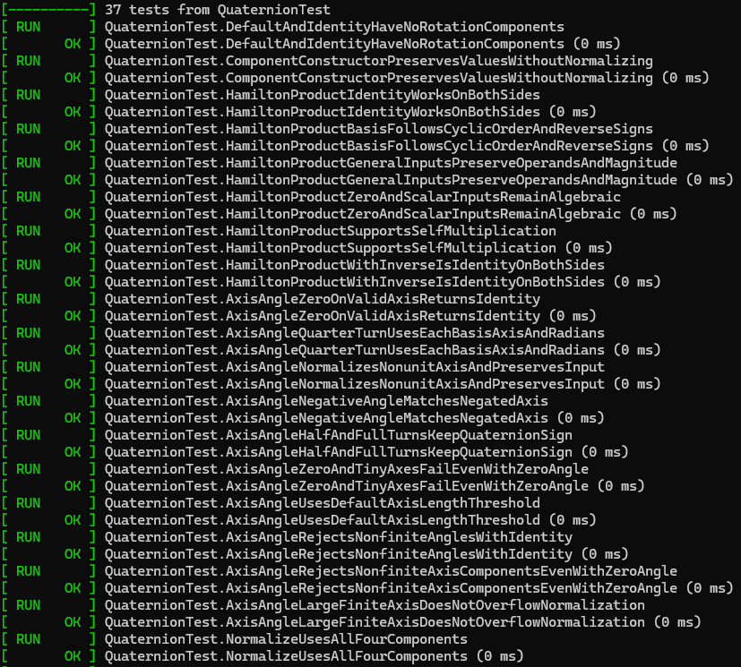 | 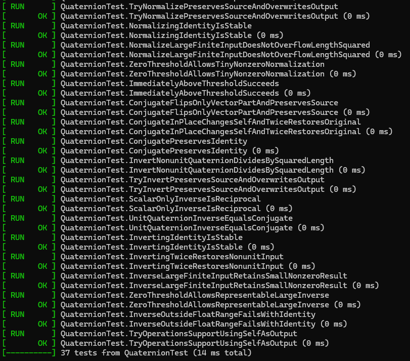 |

| QuaternionFailure (42, Release, 1/2) | QuaternionFailure (42, Release, 2/2) |
|---|---|
| 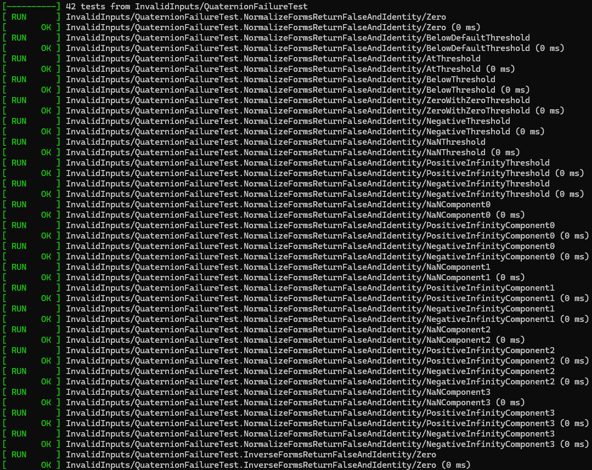 | 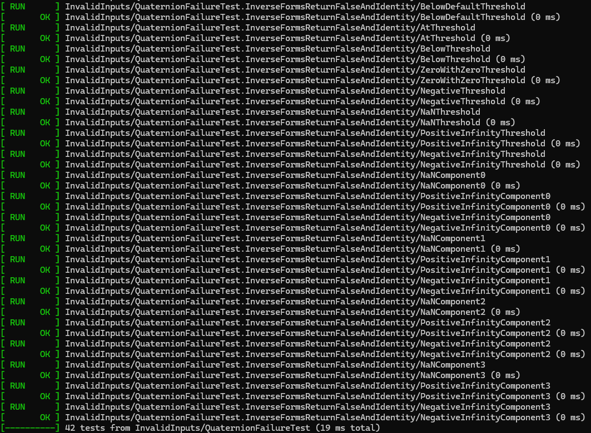 |

2026-10-14 Release 캡처는 아래 각 스위트를 따로 실행한 결과입니다. ResourceManager 화면은 2026-10-17에 별도 게시됐으며 12개 개별 OK를 직접 확인했습니다. 화면에는 실행 SHA와 빌드 경로가 없으므로 이 자료들을 최신 325개 전체 통과 기록으로 분류하지 않습니다.

| Lifecycle (14, Release, 2026-10-14) | RenderingSystem (6, 2026-10-06) | EngineInitialization (3, Release, 2026-10-11) |
|---|---|---|
| 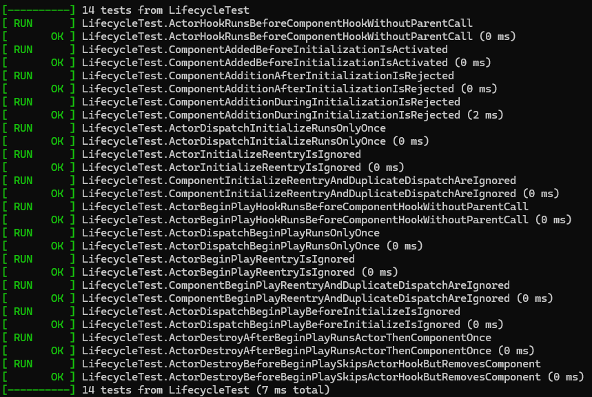 | 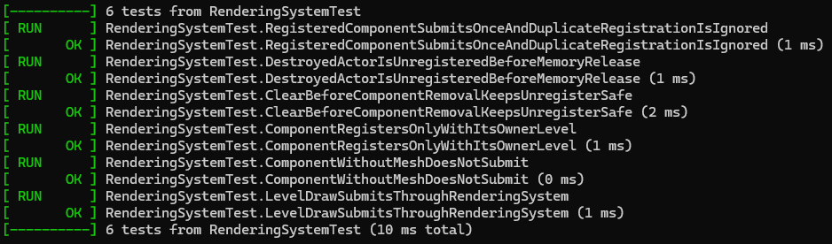 | 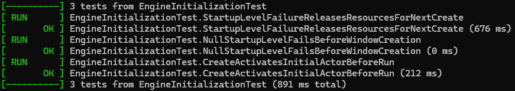 |

| SkyLightComponent (9, Release, 2026-10-14) | ScopedFlag (4, Release, 2026-10-14) | Level (13, Release, 2026-10-14) |
|---|---|---|
| 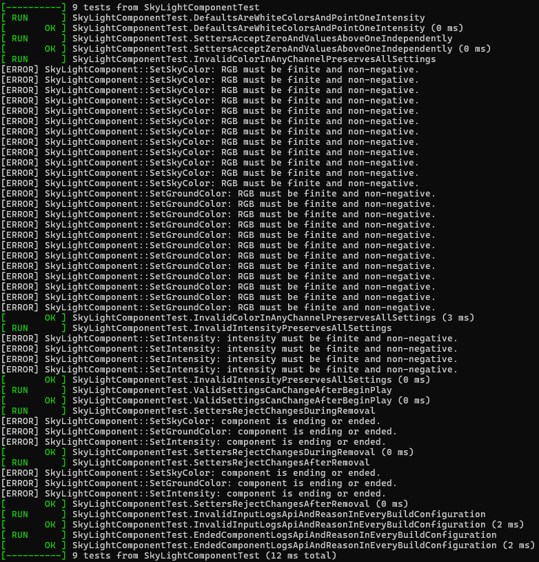 | 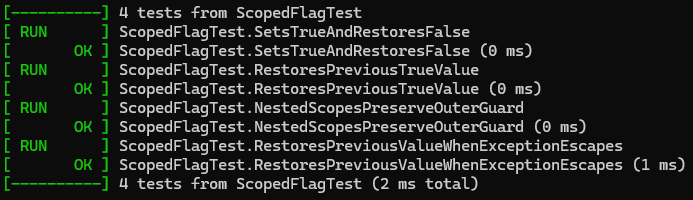 | 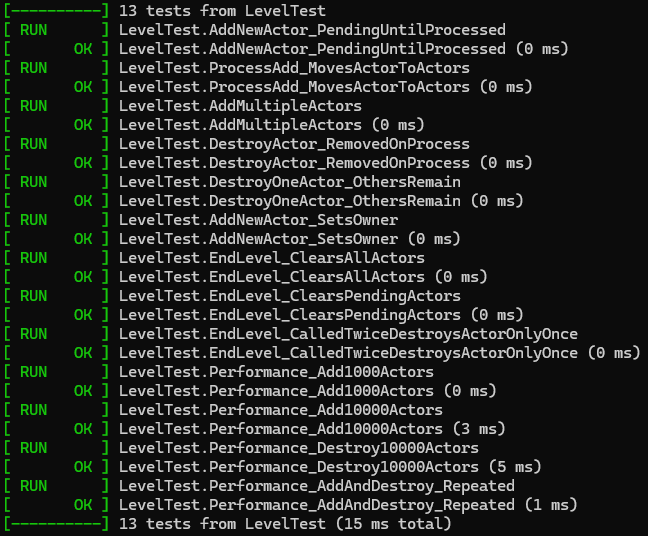 |

| EngineSettingsInitialization (2, Release, 2026-10-14) | LevelTransitionDeath (6, Release, 2026-10-14) | LevelBoundary (4, Release, 2026-10-14) |
|---|---|---|
| 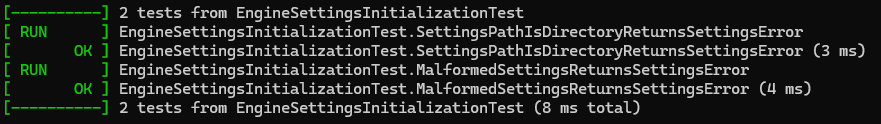 | 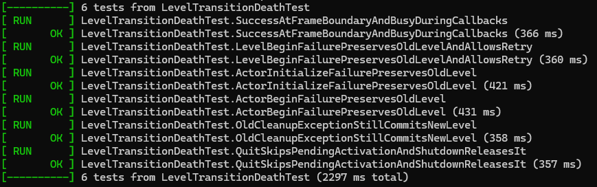 | 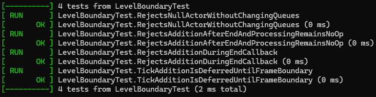 |

| LevelProcessingBoundary (8, Release, 2026-10-14) | LevelCameraBoundary (4, Release, 2026-10-14) | ResourceManager (12, 게시 2026-10-17) |
|---|---|---|
| 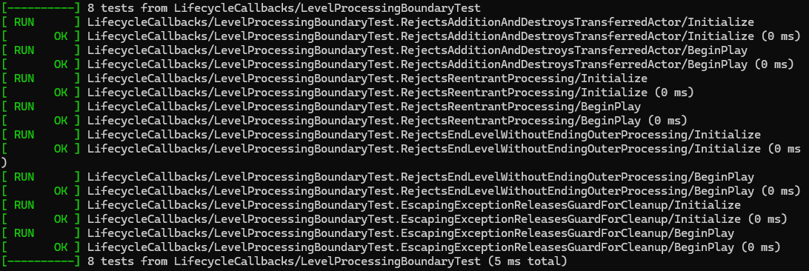 | 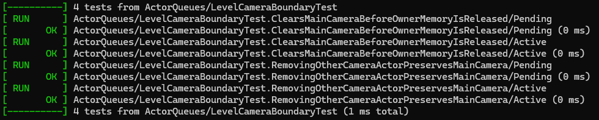 | 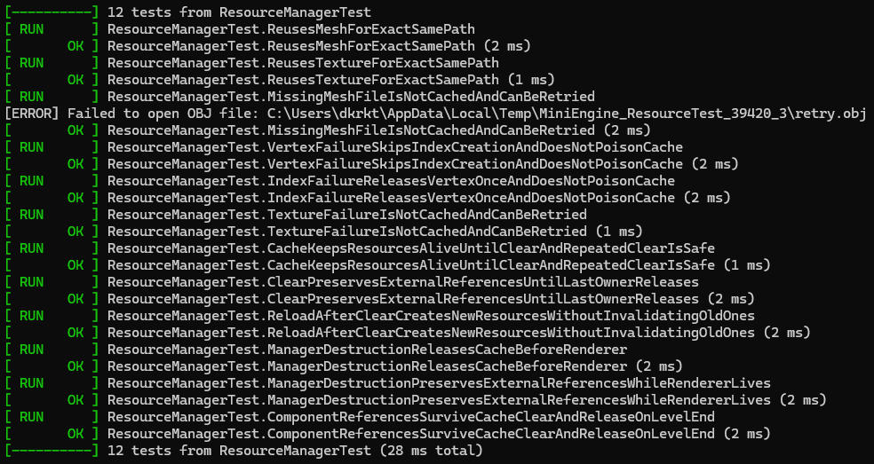 |

| Matrix4 (21) | Time (17) | Vector2 (2) |
|---|---|---|
| 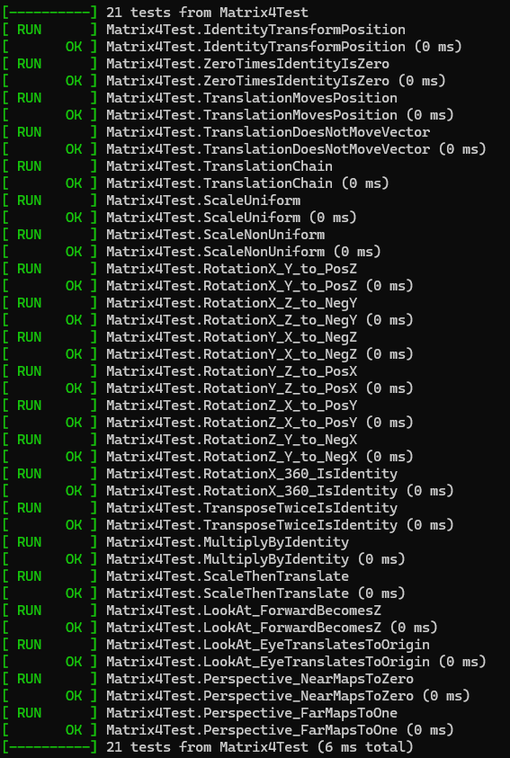 | 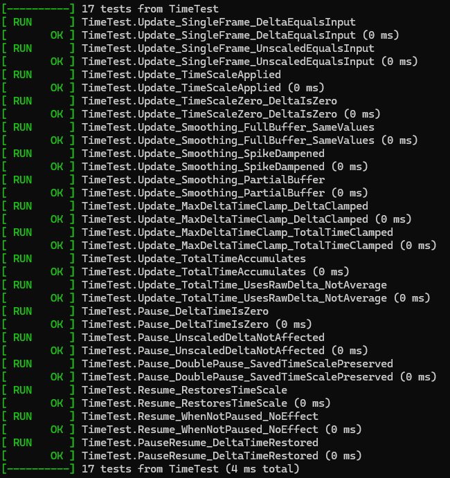 | 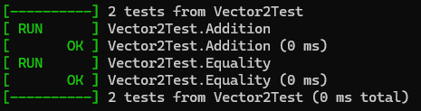 |

| Vector3 (19) | Vector4 (18) |
|---|---|
| 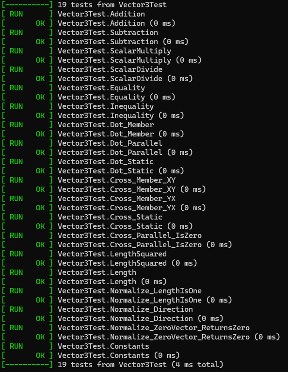 | 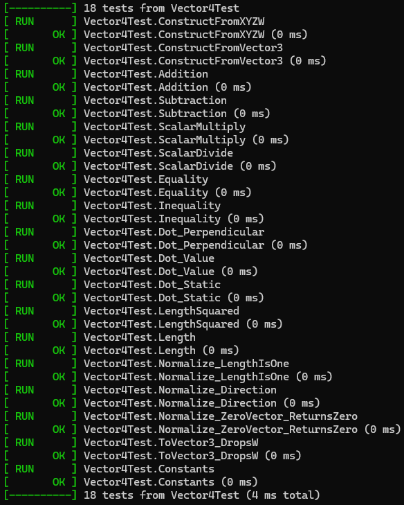 |

## 주요 설계 판단

| 판단 | 이유 |
|---|---|
| RenderPass 대신 RenderLayer | 현재 구조는 RT 소유·패스 간 SRV 의존성이 아니라 Draw 분류 버킷이므로 실제 책임에 맞게 명명 |
| Light 데이터와 Light Component 분리 | 광원 데이터가 Actor/Component 계층이나 GPU 버퍼 형식에 종속되지 않도록 경계 설정 |
| CPU Light와 GPU Constant Buffer 분리 | 의미 중심의 CPU 데이터와 정렬·전송 중심의 GPU 표현을 독립적으로 변경하기 위함 |
| RenderFrameData로 프레임 입력 전달 | 광원 컴포넌트와 RenderLayer가 직접 결합하지 않고 렌더러가 프레임 단위 데이터를 공유하도록 경계 설정 |
| 프레임 경계에서 Actor 추가·삭제 | Tick/Draw 순회 중 컨테이너 변경과 iterator 무효화 방지 |
| Handle 기반 GPU 리소스 참조 | 게임 오브젝트가 D3D11 COM 객체를 직접 소유하지 않도록 렌더러에 수명 관리 집중 |
| Engine 소유 ResourceManager | Level 교체와 무관하게 공유 리소스를 재사용하고 Renderer보다 먼저 캐시를 해제하기 위함 |
| Level 소유 RenderingSystem | 월드별 렌더 대상을 분리하고 `EndLevel()`에서 비소유 등록 목록을 명시적으로 정리하기 위함 |

## 개발 이력

| 시기 | 주요 결과 | 대표 커밋 |
|---|---|---|
| 2026-03 | Actor/Level 생명주기, Input, Component, AABB 기반 | `8827f0f` · `f17a90f` · `1cddd3d` |
| 2026-04 | DX11 초기화, 수학, RenderCommand, Time, RenderLayer, Camera | `9414065` · `6245c44` · `5595eff` · `acfc93f` |
| 2026-05 | OBJ 메시, MeshRenderer, WIC 텍스처 | `0cf264f` · `5ce9493` |
| 2026-06 | Z-up 전환, 회전 데모, 상대 에셋 경로 | `9963637` · `af58973` |
| 2026-09 | Material, BaseColor, Lambert + Ambient | `b956a29` · `c1ac4c5` · `714511c` · `dc8a878` |
| 2026-10 | RenderingSystem·방향광 통합, Bootstrap/Shutdown, 프레임 경계 Level 전환, Component·Actor 처리 경계, 리소스 캐시 검증 코드, Light 계층·SkyLight, 환경광 수집·GPU·HLSL·Game 연결, Quaternion 2-1 수학 | `381b4c2` · `f3e58f3` · `b210cdf` · `9e6ce70` · `b25aa9c` · `3bbe504` · `b669597` · `db0ab18` · `f9bb399` · `287f433` · `f87c3ef` · `e49c249` · `aa9b677` · `1f0cca8` · `b6bfc45` · `e8dfe3c` · `a5503f5` · `5239d8e` · `cc0471b` · `9bd8340` · `3f5c06d` · `4ba8c95` |

## 로드맵

[최신 Notion 개발 로드맵](https://app.notion.com/p/3218d1fa63aa817ab92eddf6e8e86b24)의 2026-10-08 개편 구조를 기준으로 진행합니다. 개발 일지와 DEVLOG의 기존 1~5-7 단계명은 당시 구현 이력이며 현재 단계 번호와 구분합니다.

| 단계 | 내용 | 상태 |
|---|---|---|
| 0 | 완료 기반 유지 · 현재 지원 범위의 제한된 안전성 점검 | 코드 반영 / 최신 325개 전체 실행 검증 대기 |
| 1 | Environment Lighting 구현과 필요한 데이터 경계 정리 | 1-1·1-2 완료 / 관련 범위 테스트·실행 화면 확인 |
| 2 | Quaternion Transform · Transform 계층 | 2-1 수학 구현 / Transform은 여전히 Euler 원본, 2-2 통합 미완료 |
| 3 | Forward Lighting 기준선 | 예정 |
| 4 | RenderTarget · RenderPass · HDR · 공용 DebugDraw | 예정 |
| 5 | Deferred Rendering | 예정 |
| 6 | Shadow · PBR · glTF 정적 Asset | 예정 |
| 7 | 안정적인 Type Registry 기반 Scene과 Resource | 예정 |
| 8 | Runtime Engine Tools | 예정 |
| 9 | Input Mapping · Collision · Character Runtime | 예정 |
| 10 | Skeletal Animation | 예정 |
| 11 | 별도 Action Framework | 예정 |
| 12 | 최소 Audio · Runtime HUD · 선택 VFX | 예정 |
| 13 | Renderer Lab · Action Combat Arena 통합 검증 | 예정 |

Environment Lighting은 로드맵의 1-1·1-2 완료 상태를 유지합니다. Quaternion 2-1 수학 API와 테스트 소스는 구현됐고 다음은 **Transform의 Quaternion 단일 원본 전환 → Local/World 합성·축 계산 → Camera·Light 회전 이전 → 실제 Game 비교 → Forward Lighting 기준선 → RenderTarget / RenderPass → Deferred Rendering → Shadow** 순서입니다. 최신 로드맵은 2-2의 회전 원본 전환부터 Camera 회전 경로 이전까지 여섯 항목을 체크했습니다. 사용자는 2026-10-21에 해당 로컬 작업이 아직 커밋 전이라고 설명했습니다. 현재 상태는 **사용자 로컬 작업 진행 / 공개 코드 반영·검증 확인 대기**로 구분합니다. 공개 `main`의 `TransformComponent`는 여전히 Euler `Vector3`를 저장하고 Euler 행렬로 World Matrix와 Forward를 계산하며 CameraActor도 Euler 입력 경로를 사용합니다. 로컬 구현의 구체 범위·통합·실행 결과는 커밋과 근거가 공개된 뒤 대조합니다. 관련 범위의 실행 기록과 최신 SHA 전체 회귀의 확인 범위는 위 검증 현황에서 구분합니다. 방향광 최대 4개 업로드는 연결됐지만 Point/Spot·Normal Matrix·색 공간 등 Forward 기준선 전체는 미완료입니다. Logging은 관련 실패 경로부터 점진적으로 적용하며 전체 완성을 기능 진입 조건으로 두지 않습니다.

## 프로젝트 구조

```text
Engine/
├─ Common/         # 생명주기 상태, 정리 예외 수집, 범위 기반 상태 가드
├─ Actor/          # Actor 생명주기와 Component 소유
├─ Component/      # Transform, Camera, Mesh, Input, Physics, Light
├─ Core/           # Win32, Input, Time, Log
├─ Engine/         # 게임 루프와 렌더러 소유
├─ Level/          # Actor 컨테이너와 프레임 경계 처리
├─ Lighting/       # Light · DirectLight · DirectionalLight · SkyLight 의미 데이터
├─ Math/           # Vector / Matrix / Quaternion
├─ Resource/       # Mesh / Texture 공유 캐시
├─ Renderer/       # D3D11, Mesh, Texture, Material, RenderLayer
├─ System/         # Collision, Lighting, RenderingSystem
└─ Shader/         # HLSL
Game/              # 엔진을 사용하는 데모 코드와 에셋
Tests/             # GoogleTest 단위 테스트
Docs/              # README 이미지와 GIF
```

## 문서

- [개발 일지 (repository)](DEVLOG.md)
- [MiniEngine 개발 일지 (Notion)](https://app.notion.com/p/3238d1fa63aa81368587d75d2c0bd738)
- [MiniEngine 개발 로드맵 (Notion)](https://app.notion.com/p/3218d1fa63aa817ab92eddf6e8e86b24)
- [Actor / Component 생명주기 정리 (Notion)](https://app.notion.com/p/3ec8d1fa63aa81cc8408db4a009803d2)
- [ResourceManager / RenderingSystem 연결 설계 (Notion)](https://app.notion.com/p/3f08d1fa63aa81c4a9d5f0b11473ab0a)
- [GitHub repository](https://github.com/yj9809/MiniEngine)
